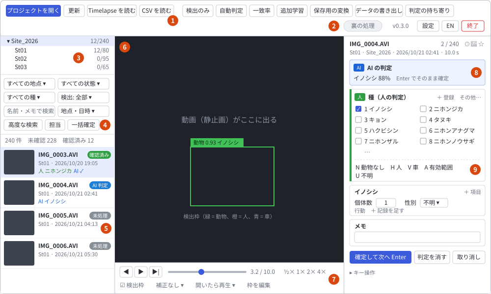

[English](README.md) | 日本語

# TrapNote

カメラトラップ（自動撮影カメラ）の動画と静止画を、手元の PC だけで整理し、種を判別するためのアプリです。

AI（MegaDetector と SpeciesNet）が付けた種の候補を人が確認し、確認した結果を使って、AI を自分の調査地に合わせて学習し直せます。結果は CSV に書き出します。



## 特徴

- **動画に対応**: カメラトラップに多い MJPEG の AVI も、変換を待たずに再生します。静止画も扱えます。
- **手元の PC で完結**: 動画をクラウドに上げません。元の動画には手を加えません。
- **プログラミング不要**: 操作はすべてブラウザの画面で行います。画面は日本語と英語を切り替えられます。
- **AI を調査地に合わせられる**: 確認した判定から学習し、学習の前後の正答率を比べられます。
- **これまでの記録を活かせる**: 既存の CSV や Timelapse2 の記録を取り込めます。

## 必要なもの

| 項目 | 内容 |
|---|---|
| OS | Windows（インストーラあり）。macOS はコマンドで入れます |
| ブラウザ | Edge または Chrome |
| ディスク | 約 10 GB（Python の環境と AI のモデル） |
| ネットワーク | インストールのときと、はじめて AI を使うときだけ |
| GPU | なくても動きます。NVIDIA の GPU（ドライバ 570 以降）があると、自動判定と学習が速くなります |

## インストール

### Windows

1. [Releases のページ](https://github.com/YoshihiroNakashima/trapnote/releases/latest) から `TrapNote-Setup-….exe` を取ってきて、実行します。
   「Windows によって PC が保護されました」と出たら、「詳細情報」→「実行」を押します。
2. 入れるフォルダ（既定は `C:\TrapNote`）を確かめて、「インストール」を押します。10〜30 分かかります。
3. デスクトップにできた「TrapNote」のアイコンから起動します。

### macOS

```
git clone https://github.com/YoshihiroNakashima/trapnote.git
cd trapnote
conda env create -f env/trapnote-env.yml
conda activate trapnote
pip install --no-deps megadetector==10.0.28
python app.py
```

新しい版への入れ替え、アンインストール、うまく入らないときの対処は、[取扱説明書の 2 章](docs/manual.ja.md#2-インストールと起動) にあります。

## はじめての使い方

1. 「プロジェクトを開く」で、動画のフォルダ（地点ごとのフォルダが入っている親フォルダ）を選びます。
2. 「地点のフォルダを選ぶ」の画面で、カメラを置いた地点にあたるフォルダを選びます。
3. 「自動判定」を押して「始める」。AI が動画ごとに種の候補を付けます。
4. 動画を見て、合っていれば Enter で確定します。違っていれば、種を選び直してから Enter。
5. 「CSV の書き出し」で結果を保存します。

確認した動画がたまったら、「追加学習」で AI を調査地に合わせられます。くわしい手順は **[取扱説明書](docs/manual.ja.md)** を見てください。

## 文書

| 文書 | 内容 |
|---|---|
| [取扱説明書](docs/manual.ja.md)（[英語版](docs/manual.md)） | 使い方の全体（インストール、確認の作業、追加学習、書き出し）、キー操作、困ったとき |
| [詳細仕様と開発メモ](docs/technical-notes.md) | 判定の規則の数値、研究用の版の手順、保存の形式、プログラムの構成、試験の方法 |
| [確認事項.md](確認事項.md) | 変更の記録 |

## 引用

論文を準備中です。公表までは、このリポジトリの URL と、使った版（v0.3.0 など）を記してください。

## ライセンス

MIT License（[LICENSE](LICENSE)）。MegaDetector（MIT）と SpeciesNet（Apache 2.0）のモデルは、初回の実行時に各配布元から取ってくるもので、このリポジトリには含みません。
