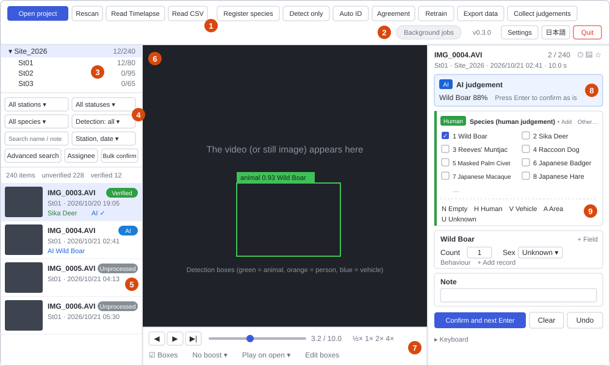

English | [日本語](README.ja.md)

# TrapNote

TrapNote is an app for organising camera-trap videos and still images and identifying the species in them, entirely on your own PC.

The AI (MegaDetector and SpeciesNet) suggests a species for each video, a person checks the suggestion, and the checked results can be used to retrain the AI for your own study site. Results are exported as CSV.



## Features

- **Built for video**: plays the MJPEG AVI files common in camera traps without waiting for conversion. Still images work too.
- **Runs on your own PC**: videos are never uploaded to the cloud, and the original files are left untouched.
- **No programming**: everything is done in a browser window. The interface can be switched between English and Japanese.
- **Adapts the AI to your study site**: retrain from your verified judgements and compare the accuracy before and after training.
- **Reuses your existing records**: import existing CSV files and Timelapse2 records.
- **Exports in standard formats**: besides CSV, export as Camtrap DP (the standard format for publishing and sharing camera-trap data) or in YOLO format (training data for object detection: images of video frames with their labels).

## Requirements

| Item | Details |
|---|---|
| OS | Windows (installer available). On macOS, install from the command line |
| Browser | Edge or Chrome |
| Disk | About 10 GB (Python environment and AI models) |
| Network | Only during installation and the first time the AI is used |
| GPU | Not required. An NVIDIA GPU (driver 570 or later) makes Auto ID and training faster |

## Installation

### Windows

1. Download `TrapNote-Setup-….exe` from the [Releases page](https://github.com/YoshihiroNakashima/trapnote/releases/latest) and run it.
   If Windows shows "Windows protected your PC", click "More info" and then "Run anyway".
2. Check the install folder (default `C:\TrapNote`) and click "Install". Installation takes 10–30 minutes.
3. Start TrapNote from the "TrapNote" icon on the desktop.

### macOS

```
git clone https://github.com/YoshihiroNakashima/trapnote.git
cd trapnote
conda env create -f env/trapnote-env.yml
conda activate trapnote
pip install --no-deps megadetector==10.0.28
python app.py
```

Updating to a new version, uninstalling and fixing installation problems are covered in [chapter 2 of the user manual](docs/manual.md#2-installing-and-starting).

## Getting started

1. Click "Open project" and choose your video folder (the parent folder that contains one folder per station).
2. In the "Choose the station folder" window, select the folders that correspond to your camera stations.
3. Click "Auto ID", then "Start". The AI suggests a species for each video.
4. Watch each video. If the suggestion is right, press Enter to confirm it. If it is wrong, choose the correct species first, then press Enter.
5. Save the results with "Export CSV".

Once you have verified enough videos, "Retrain" adapts the AI to your study site. See the **[user manual](docs/manual.md)** for the full procedure.

## Documentation

| Document | Contents |
|---|---|
| [User manual](docs/manual.md) ([Japanese](docs/manual.ja.md)) | How to use the app: installation, verification, retraining, export, keyboard shortcuts and troubleshooting |
| [Technical notes](docs/technical-notes.md) (in Japanese) | Thresholds of the judgement rules, procedures of the research edition, storage format, program structure and testing |
| [確認事項.md](確認事項.md) (in Japanese) | Change log |

## Citation

A paper is in preparation. Until it is published, please cite the URL of this repository and the version you used (for example, v0.3.0).

## License

MIT License ([LICENSE](LICENSE)). The MegaDetector (MIT) and SpeciesNet (Apache 2.0) models are downloaded from their distributors the first time they are used and are not included in this repository.
