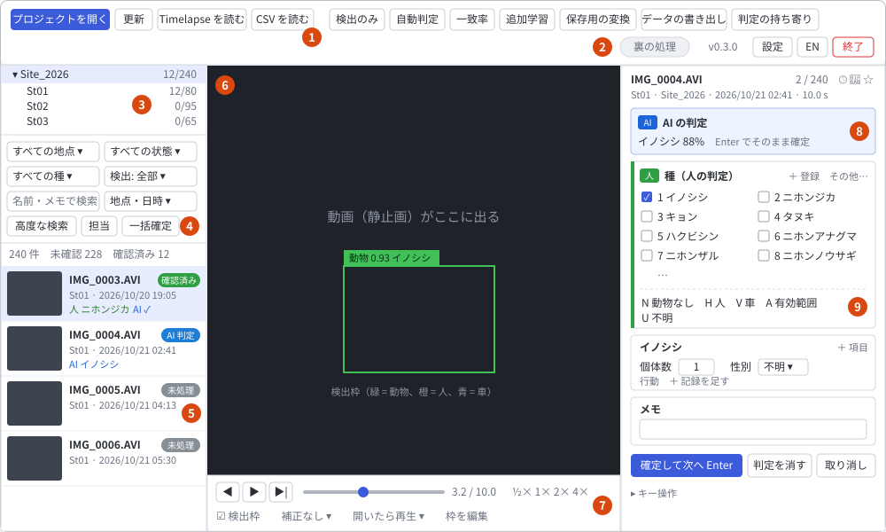

[English](manual.md) | 日本語

# TrapNote 取扱説明書

この説明書は、TrapNote v0.3.0 の公開版（ふつうのアイコンから起動する版）の使い方をまとめたものです。
はじめての方は 1〜4 章を順に読めば、動画を開いて CSV に書き出すところまで進めます。5 章からあとは、必要になったときに読んでください。

## 目次

1. [TrapNote でできること](#1-trapnote-でできること)
2. [インストールと起動](#2-インストールと起動)
3. [画面の見かた](#3-画面の見かた)
4. [はじめての作業](#4-はじめての作業)
5. [確認の作業を速くする](#5-確認の作業を速くする)
6. [記録する内容を増やす](#6-記録する内容を増やす)
7. [AI を調査地に合わせる](#7-ai-を調査地に合わせる)
8. [既存の記録を取り込む](#8-既存の記録を取り込む)
9. [ほかの形式で書き出す](#9-ほかの形式で書き出す)
10. [複数の人や PC で分担する](#10-複数の人や-pc-で分担する)
11. [複数の調査回をまとめる](#11-複数の調査回をまとめる)
12. [動画を整理する](#12-動画を整理する)
13. [データの置き場所と持ち運び](#13-データの置き場所と持ち運び)
14. [キー操作の一覧](#14-キー操作の一覧)
15. [3 つの版](#15-3-つの版)
16. [困ったとき](#16-困ったとき)
17. [用語](#17-用語)

---

## 1. TrapNote でできること

TrapNote は、カメラトラップの動画と静止画を読み込み、写っている動物の種を記録して、CSV に書き出すアプリです。作業は次の順に進みます。

1. **開く**: 動画のフォルダを選ぶと、動画が一覧に並びます。
2. **自動判定**: AI が動物・人・車を見つけ（MegaDetector）、動物には種の候補を付けます（SpeciesNet）。
3. **確認**: 人が動画を見て、合っていればそのまま確定し、違っていれば直します。
4. **書き出し**: 結果を CSV に書き出します。Camtrap DP（データの公開や共有のための標準の形式）や、YOLO（物体検出の学習データ）の形式でも書き出せます。
5. **追加学習**（必要なら）: 確認した結果で AI を学習し直し、残りの動画や次の調査の判定に使います。

AI を使わずに、目視だけで記録することもできます。

知っておくとよいこと:

- 動画はどこにも送られません。処理はすべて手元の PC で行います。
- 結果は、開いた動画のフォルダの中にできる `TrapNote` フォルダにまとまります。
- 元の動画には手を加えません。例外は、自分で実行する「削除」だけです（[12.2](#122-削除)）。

---

## 2. インストールと起動

### 2.1 必要なもの

| 項目 | 内容 |
|---|---|
| OS | Windows（インストーラあり）。macOS はコマンドで入れます |
| ブラウザ | Edge または Chrome |
| ディスク | 約 10 GB（Python の環境と AI のモデル） |
| ネットワーク | インストールのときと、はじめて AI を使うときだけ |
| GPU | なくても動きます。NVIDIA の GPU（ドライバ 570 以降）があると、自動判定と学習が速くなります |

### 2.2 Windows に入れる

1. `TrapNote-Setup-….exe` を実行します（[Releases のページ](https://github.com/YoshihiroNakashima/trapnote/releases/latest) か、配られたファイル）。
   「Windows によって PC が保護されました」と出たら、「詳細情報」→「実行」を押します。
2. 入れるフォルダを確かめて、「インストール」を押します。
   - 既定は `C:\TrapNote` です。フォルダ名は半角の英数字だけにしてください。
   - 10〜30 分かかります。その間、インターネットにつないだままにします。
   - PC に前からある Anaconda などには影響しません（専用の Python の環境を、入れるフォルダの中に作ります）。
3. 終わると、デスクトップに「TrapNote」のアイコンができます。

はじめて「自動判定」か「検出のみ」を使うときに、AI のモデル（合わせて 300 MB ほど）を取ってきます。このときもインターネットが要ります。

### 2.3 macOS に入れる

conda（Miniforge など）が入っている状態で、ターミナルから次を実行します。

```
git clone https://github.com/YoshihiroNakashima/trapnote.git
cd trapnote
conda env create -f env/trapnote-env.yml
conda activate trapnote
pip install --no-deps megadetector==10.0.28
python app.py
```

2 回目からは `conda activate trapnote` のあと `python app.py` で起動します。

### 2.4 起動と終了

- **起動**: デスクトップの「TrapNote」のアイコンをダブルクリックします。専用の窓に画面が開きます。
- **終了**: 画面の右上の「終了」を押します。窓を閉じるだけでは、プログラムは裏で動いたままです（もう一度アイコンを押せば、画面がまた開きます）。
- 画面の言語は、右上の「EN」（英語の画面では「日本語」）か、「設定」の「言語」で切り替えます。

### 2.5 新しい版にする、消す

- **新しい版にする**: 新しい `TrapNote-Setup-….exe` を実行して、同じフォルダを指定します。プログラムだけが入れ替わり、設定、モデル、これまでの判定はそのまま残ります。
- **消す**: デスクトップのアイコンと、入れたフォルダ（`C:\TrapNote`）を消します。動画のフォルダの中の `TrapNote` フォルダ（判定の結果）は、自分で消さない限り残ります。
- **うまく入らないとき**: [16 章](#16-困ったとき) を見てください。

---

## 3. 画面の見かた



| 番号 | 名前 | 役割 |
|---|---|---|
| 1 | ツールバー | 作業を始めるボタンが並びます。左から、プロジェクトを開く、更新、Timelapse を読む、CSV を読む、種の登録、検出のみ、自動判定、一致率、追加学習、データの書き出し、判定の持ち寄り |
| 2 | 裏の処理、設定、終了 | 「裏の処理」は、走査や自動判定などの進み具合です。押すと詳しく見られ、止めることもできます |
| 3 | フォルダの木 | フォルダを押すと、その中の動画だけが一覧に出ます。数字は「確認済みの数 / 全部の数」です |
| 4 | 絞り込みと並べ替え | 地点、状態、種、検出の結果などで一覧を絞り込みます |
| 5 | 一覧 | 動画 1 本が 1 行です。押すと再生されます。右上の札が状態です |
| 6 | 再生画面 | 動画（静止画）が出ます。「検出枠」にチェックがあると、AI が見つけた場所に枠が重なります |
| 7 | 再生の操作 | 前後の動画、コマ送り、再生の速さ、暗い動画の補正など |
| 8 | AI の判定 | AI が付けた種の候補と確からしさ。青い箱です |
| 9 | 人の判定 | 種のチェック、動物なしなどの固定項目、個体数などの項目、メモ、「確定して次へ」。ここに入れたものが記録になります |

欄の境目はドラッグで動かせます（ダブルクリックで元に戻ります）。

一覧の札の意味:

| 札 | 意味 |
|---|---|
| 未処理 | まだ判定がない |
| AI 判定 | AI の判定が入っているが、人はまだ確認していない |
| 取り込み | CSV や Timelapse から取り込んだ判定が入っているが、まだ確認していない |
| 確認済み | 人が確定した |

---

## 4. はじめての作業

### 4.1 動画のフォルダを用意する

地点（カメラを置いた所）ごとにフォルダを分けておくと、地点での絞り込みや、CSV の地点の列にそのまま使えます。

```
Site_2026/          ← このフォルダを開く
  St01/             ← 地点ごとのフォルダ
    IMG_0001.AVI
    IMG_0002.AVI
  St02/
  St03/
```

同じ地点を、時期を変えて何度も調査していて、地点のフォルダの中が調査回ごとのフォルダに分かれている場合は、地点のフォルダが並んでいるフォルダを開きます。

```
Site/               ← このフォルダを開く
  St01/             ← 地点ごとのフォルダ
    2026_05/        ← 調査回ごとのフォルダ
      IMG_0001.AVI
      IMG_0002.AVI
    2026_10/
  St02/
    2026_05/
    2026_10/
```

この並びでは、全部の調査回が 1 つのプロジェクトに入ります。地点と調査回のフォルダは、プロジェクトを開いたあとの画面で選びます（[4.3](#43-地点のフォルダを選ぶ)）。

読める形式は、動画が AVI、MP4、MOV、MKV、M4V、MPG、WMV、MTS、3GP、WebM、静止画が JPG、PNG です。

### 4.2 プロジェクトを開く

1. 左上の「プロジェクトを開く」を押します。
2. 左のカード「調査回のプロジェクト（動画のフォルダ）」で「選ぶ…」を押し、動画のフォルダ（上の例では `Site_2026`）を選んで「開く」を押します。
   フォルダのパスを、ツールバーの欄に貼り付けて Enter を押しても開けます。
3. 動画が一覧に並びます。長さや撮影日時は、裏で順に読み取っていきます（右上の「裏の処理」に進み具合が出ます）。

このとき、開いたフォルダの中に `TrapNote` フォルダができます。判定などの結果は、すべてここに入ります。
次回からは、「プロジェクトを開く」の「最近のプロジェクト」から選べます。動画を足したり減らしたりしたときは、「更新」を押すと一覧に反映されます。

> **撮影日時について**: 撮影日時は、動画の中の情報、EXIF、ファイルの更新時刻の順に探します。AVI には撮影日時が入っていないことが多く、そのときはファイルの更新時刻を使います（一覧に `(mtime)` と出ます）。カメラの時計がずれていた場合は、あとで直せます（[6.4](#64-カメラの時計のずれを直す)）。

### 4.3 地点のフォルダを選ぶ

新しいプロジェクトでは、読み込みのあとに「地点のフォルダを選ぶ」の画面が出ます。

1. フォルダの並びの中から、地点にあたるフォルダ（上の例では `St01`）を押します。同じ階層のフォルダが、すべて地点になります。
2. 下の表で、地点の数と動画の数を確かめます。
3. 「この階層を地点にする」を押します。

- 同じ地点を時期を変えて何度も調査していて、その時期ごとのフォルダも中にあるときは、「調査回（あれば）」も選びます（選び方は、下の「地点のフォルダの中に、調査回のフォルダがあるとき」）。ふつうは「なし」のままで構いません。
- あとで変えるときは、「設定」の「地点のフォルダ」の「選び直す…」を押します。
- 地点を選ばなくても使えます。その場合、CSV にはフォルダの各階層が `Folder1`、`Folder2` … の列で出ます。

**地点のフォルダの中に、調査回のフォルダがあるとき**（[4.1](#41-動画のフォルダを用意する) の 2 つ目の例）

1. 画面は、はじめ、動画のすぐ上のフォルダ（例では `2026_05`）を地点に選んだ状態で出ます。地点にあたるフォルダ（`St01`）を押して、選び直します。
2. 「調査回（あれば）」で、調査回にあたるフォルダ（「2026_05」の階層）を選びます。
3. 下の表で、地点の数と調査回の数、フォルダごとの地点と調査回を確かめます。
4. 「この階層を地点にする」を押します。

- 選び直さないと、調査回のフォルダの名前（`2026_05` など）が地点になります。
- あとで新しい調査回のフォルダを足したときは、「更新」を押します。足した動画にも、同じ決め方で地点と調査回が付きます。

### 4.4 種を登録する

右の欄に並ぶ種と、自動判定が付ける種は、種リストで決まります。自動判定は、種リストで「使う」にした種だけを付け、ほかの動物は「不明」にします。調査地で写りうる種を、自動判定の前に登録しておいてください。

- 日本語の画面で作ったプロジェクトには、はじめから、日本の哺乳類を中心にした 31 項目が入っています。
- 英語の画面で作ったプロジェクトは、種が空の状態から始まります（「動物なし」「人」「車」「有効範囲」「不明」は、いつもあります）。調査地の国も未設定です。

1. ツールバーの「種の登録」を押します。
2. 「調査地の国」に、国の名前か、ISO の 3 文字（日本は JPN）を入れます。入れると、その国にいる種の候補（自動判定の AI = SpeciesNet が知っている種）が、窓の下にすぐ出ます。自動判定は、その国にいない種の候補を除きます。
3. 「登録した種」の表で、調査地で写りうる種の「使う」にチェックを付けます。表にない種は、下の候補にチェックを付けて「選んだ種を登録」を押すと、表に入ります（はじめは哺乳類だけが出ます。鳥類なども出せます）。
4. 候補にない種は、「＋ 種を登録」で足します。登録のしかたは、次の 3 つです。
   - **1 種ずつ入れる**: 名前と学名を入れます。学名を打つと、自動判定で付くかどうかが出ます。
   - **CSV からまとめて登録**: 「ひな形を書き出す」で CSV を書き出し、Excel などで 1 行に 1 種を書き足してから、「CSV を選ぶ」で読み込みます。読み込む前に、新しく登録される種と、書き換えられる種が表に出ます。
   - **SpeciesNet の候補から選ぶ**: 窓の下に出る候補と同じ一覧です（右の欄の「＋ 登録」から開いたとき用）。
5. よく使う種には「キー」（1 文字）を決めておくと、キーボードで選べます。キーは、動画を見る画面の「キー設定」でも決められます（[4.6](#46-動画を見て確定する)）。
6. 「保存」を押します。候補にチェックを付けたままの種も、一緒に登録されます。

候補の一覧は、SpeciesNet のモデルを取ってきたあとで使えます。まだのときは、候補の欄に「いまモデルを取ってくる」のボタンが出ます（自動判定をはじめて使うときに取ってくるものと同じです）。候補から登録した種には、学名と、自動判定との対応が、そのまま入ります。

種の名前は、役割ごとに 3 つあります。

| 名前 | 使われるところ |
|---|---|
| 和名・英名 | 画面に出る名前。日本語の画面では和名、英語の画面では英名（ないときは、もう一方 → 学名） |
| 学名 | 自動判定（SpeciesNet）と Camtrap DP 形式は、学名でつなぎます |
| CSV 表記 | 書き出す CSV の Species の列に入る値。これまでの CSV と同じ表記にしておくと、あとで合わせやすくなります |

表の「自動判定」の列は、その種が自動判定で付くかどうかです。

| 表示 | 意味 |
|---|---|
| 種で対応 | SpeciesNet に、その種があります |
| 属で対応（科・目・綱も同じ） | SpeciesNet にその種がなく、同じ属の候補を、その種に集めます |
| 対応なし | 自動判定では付きません（学名が空か、SpeciesNet にない学名）。目で判別するときは使えます |
| 未確認 | SpeciesNet のモデルをまだ取ってきていないので、分かりません |

> **日本以外で使うとき**: 「調査地の国」を、調査地の国（ISO の 3 文字）にしてください。JPN のままにすると、日本にいない種の候補が除かれます。空にすると制限しません。

### 4.5 自動判定をかける

1. ツールバーの「自動判定」を押します。
2. 「範囲」（すべて、または、いまの絞り込み）を確かめます。ほかは、ふつうは既定のままで構いません。
3. 「始める」を押します。進み具合は、右上の「裏の処理」に出ます。

- 途中で止めても、済んだ動画は飛ばして、続きから再開できます。
- 自動判定の間も、動画を見て確認の作業を進められます。
- GPU がない PC でも動きます。時間の目安は、20 秒の動画 1 本あたり、検出のみで 2〜10 秒、自動判定で 3〜20 秒です（CPU によって変わります。動画が長ければ、ほぼ長さに比例します）。実際の速さは、「裏の処理」に「○ 秒/本」と出ます。1 本に何十秒もかかるときは、[16. 困ったとき](#16-困ったとき) を見てください。
- 窓の「自動判定が付ける種」の欄に、種リストのうち自動判定で付く種が出ます。ここにない動物は「不明」になります。1 つもないときは、始められません。「種を登録する」を押して、種を登録してください（[4.4](#44-種を登録する)）。

自動判定が済むと、動画ごとに次のどれかになります。

| 結果 | 意味 |
|---|---|
| 種の候補（AI 判定） | 動物が写っていて、種の候補が付いた |
| 要確認 | 動物は写っているようだが、自信が低いので種を付けていない |
| 動物なし | 動物も人も車も見つからなかった |
| 人、車 | 人や車が写っている |

種は自分の目で付けたい場合は、「自動判定」の代わりに「検出のみ」を使います。動物・人・車の枠だけを付け、種の候補は付けません。

### 4.6 動画を見て確定する

一覧の動画を押すと、再生が始まります。右の欄で判定を確かめて、確定します。

- **AI の判定が合っているとき**: Enter を押します。確定して、次の動画に進みます。
- **違っているとき**: 種のチェックを付け替えてから Enter を押します。キーを決めた種は、そのキーでも切り替えられます。1 本に 2 種以上写っていれば、両方にチェックを付けます。
- **動物が写っていないとき**: N（動物なし）を押して Enter。人は H、車は V、種が分からないものは U（不明）です。A（有効範囲）は、有効範囲の確認用に撮った動画に付ける項目です。
- **間違えて確定したとき**: Ctrl+Z で、直前の確定を取り消せます。あとで直すときは、その動画を開いて付け直すか、「判定を消す」を押します。

種を選ぶキーを決める:

1. 右の欄の「キー設定」を押します。
2. 種の行を選んで（押すか、矢印キー）、付けたいキー（英字か数字）を押します。付けると、次の種に進みます。Backspace で外せます。
3. 「保存」を押します（Enter でも保存できます）。右の欄の種の名前の前に、決めたキーが出ます。

- 「キーのない種に数字を付ける」を押すと、キーのない種に、上から順に、空いている数字が付きます。
- ほかの種が使っているキーを付けると、そのキーは、前の種から外れます。
- N、H、V、A、U と、Space、, . < >、[ ] は、種には付けられません。F、B、L、-、+ は付けられますが、付けている間、お気に入り・明るさの補正・ループは、キーではできません（画面のボタンや欄でできます）。

見やすくする機能:

- 再生の下の「検出枠」にチェックを付けると、AI が動物を見つけた場所が分かります。
- 暗い動画は、B キーで明るさを補正できます（表示だけで、記録には影響しません）。
- , と . でコマ送り、[ と ] で再生の速さを変えられます。キーの一覧は [14 章](#14-キー操作の一覧) にあります。

> **→ キーに注意**: → と ← は前後の動画に移るキーですが、種にチェックが入っていると、確定してから移ります。

### 4.7 CSV に書き出す

1. ツールバーの「データの書き出し」を押します。
2. 「範囲」（すべて、いまの絞り込み、確認済みだけ）を選びます。
3. 「CSV（表）」のカードを開き（はじめは開いています）、「保存先」を確かめて、「CSV を書き出す」を押します。

CSV は、**動画 1 本 × 種 1 つで 1 行**です。1 本に 2 種が写っていれば、2 行になります。おもな列は次のとおりです。

| 列 | 内容 |
|---|---|
| Season、Station、File | 調査回、地点、ファイル名 |
| DateTime | 撮影日時（例 `2026/10/20 19:05:21`） |
| DateTimeCorrected | 時計のずれを直したあとの日時。直していなければ DateTime と同じ |
| Species | 種（種リストの「CSV 表記」。動物なしは Empty、人は Human、車は Vehicle、不明は Unknown） |
| Species_ja、Species_sci | 和名と学名 |
| Status、Verified、VerifiedBy | 確認の状態と、確認した人 |
| Note、Favorite | メモ、お気に入り |
| AutoJudgement、Agree | AI の判定と、人の判定との比較（match = 一致、partial = 部分一致、mismatch = 不一致） |
| Flag、DetAnimal、DetPerson、DetVehicle、DetMaxConf | 要確認の印（low）と、検出の要約 |
| 追加項目の列 | 個体数など、自分で足した項目（[6.1](#61-個体数や行動などの項目を足す)） |

Camtrap DP や YOLO の形式で書き出すときは、[9 章](#9-ほかの形式で書き出す) を見てください。

---

## 5. 確認の作業を速くする

### 5.1 絞り込みと並べ替え

一覧の上の欄で、見る動画を絞り込めます。

| 欄 | できること |
|---|---|
| 地点、調査回 | その地点、その調査回の動画だけにする |
| 状態 | 未処理、未確認（判定あり）、確認済みで絞る |
| 種 | 種で絞る。人の判定で絞るか、AI の判定で絞るかを選べます |
| 検出 | 要確認、AI と不一致、AI と一致、検出で動物なし、枠の数など |
| 名前・メモで検索 | ファイル名やメモの文字で探す |
| 並べ替え | 地点・日時、日時、名前、状態、信頼度など |
| ★ | お気に入りだけにする |

絞り込みは、フォルダの選択とは別に適用され、次に起動したときも残ります。絞り込んでいる間は、件数の横に青い「絞り込み中 n ✕」が出ます。**一覧に何も出ないときは、まずこれを押して絞り込みを外してください。**

「高度な検索」を押すと、条件を細かく決める窓が別に開きます（複数の地点や種の指定と除外、時刻、動画の長さ、記録した項目）。よく使う条件は保存できます。

### 5.2 まとめて選ぶ

- Ctrl+A で、いまの一覧の全部を選びます。Shift+クリックで範囲、Ctrl+クリックで 1 本ずつ足せます。Esc で解除します。
- 選んでいる間は、右の欄の操作が、選んだ全部に適用されます。たとえば、種を入れて「確定して次へ」を押すと、選んだ全部に同じ判定が付きます。
- 一覧の上に出る帯から、まとめてお気に入りにする、削除する、などができます。右クリックでも同じ操作ができます。

### 5.3 一括確定

「一括確定」は、いまの絞り込みに入っている未確認の判定を、まとめて確認済みにする機能です。たとえば、「検出で動物なし」で絞り込んでから使うと、動物が写っていない動画を 1 本ずつ見ずに済みます。

- 一括確定は Ctrl+Z では戻せません。先に絞り込みを確かめてから使ってください。
- 対象の中に、検出で枠が付かなかった動画があるときは、「抜き取りの確認」ができます。その中から無作為に選んだ動画を目で見て、動物の見落としがどれくらいあるかを見積もる機能です。たとえば 100 本を見て 1 本も動物がいなければ、見落としは約 3 % 以下（95 % の上限）と言えます。結果はプロジェクトに記録されます。

---

## 6. 記録する内容を増やす

### 6.1 個体数や行動などの項目を足す

種のほかに記録したい項目（個体数、性別、行動など）は、自分で足せます。

- 右の欄の「＋ 項目」を押すと、その場で項目を足せます。足した項目はすぐに欄に出て、CSV の列にもなります。
- 項目には、種ごとに記録するもの（個体数など）と、動画ごとに記録するものがあります。型は、選択肢、チェック、数値、自由記述、時刻などから選べます。
- 行動のように、1 本の動画に何件も記録したい項目は、「＋ で 1 本に何件でも記録する」にチェックを付けます。
- 並べ替え、削除、細かい直しは、「設定」→「追加項目を編集…」で行います。

### 6.2 種リストにない種が写っていたとき

- 「その他…」を押すと、種リストにあるが「使う」にしていない種を選べます。
- 「＋ 登録」を押すと、新しい種を登録できます。登録のしかた（1 種ずつ入れる、CSV からまとめて、SpeciesNet の候補から）を選びます（[4.4](#44-種を登録する)）。1 種ずつ入れたときは、いま開いている動画に、その種が付きます。

### 6.3 メモとお気に入り

- 「メモ」の欄に、気づいたことを書けます。CSV の Note の列に出ます。
- ☆（または F キー）で、お気に入りの印を付けられます。きれいに撮れた動画や、珍しい行動の動画を、あとで探すのに使えます。

### 6.4 カメラの時計のずれを直す

1. ずれが分かっている動画を開き、右の欄の上の 🕓 を押します。
2. その動画の正しい日時を入れます。ずれの大きさが決まります。
3. 同じずれを足す範囲（この動画だけ、このフォルダ、この地点、いまの絞り込み）を選びます。
   調査回が 2 つ以上あるプロジェクトでは、「この地点」は、その地点の全部の調査回の動画に掛かります。1 つの調査回だけ直すときは、「このフォルダ」を選ぶか、地点と調査回で絞り込んでから「いまの絞り込み」を選びます。

元の日時は消えません。CSV には、元の日時（DateTime）と直したあとの日時（DateTimeCorrected）の両方が出ます。

---

## 7. AI を調査地に合わせる

自動判定の種の候補は、最初は世界共通のモデル（SpeciesNet）によるものです。確認した動画がたまったら、「追加学習」で、種の判別を自分の調査地とカメラに合わせ込めます。

### 7.1 方式

| 方式 | 内容 | 向いている場合 |
|---|---|---|
| 方式 A（軽い分類器） | 自動判定のときに保存した特徴量から、軽い分類器を学習します。CPU でも数分で済みます | まずはこちら |
| 方式 B（本体の再学習） | SpeciesNet 本体の一部を学習し直します。GPU と時間が要ります | 方式 A で足りないとき |

### 7.2 手順

1. **自動判定をかける**（[4.5](#45-自動判定をかける)）。追加学習は、このとき保存した情報を使います。
2. **動画を確認して確定する**（[4.6](#46-動画を見て確定する)）。確認済みの動画が、学習の材料になります。確認済みの動画が少ない種（学習に使える枠が 5 枚未満）は、学習に入りません。
3. **「追加学習」を押す**。窓の上に、学習に使える動画の数が出ます。方式を選び、名前を付けて、「学習を始める」を押します。
4. **結果を見る**。地点の一部（既定で 2 割）を検証用に取り分け、学習に使わなかったその地点の動画で、学習前と学習後の一致率を比べます。地点が 3 つ未満のときは、この評価はできません。
5. **判定を付け直す**。「学習したモデル」の表の「付け直す」を押すと、学習したモデルで AI の判定を付け直します。確認済みの判定は変わりません。これ以後の自動判定も、そのモデルで行います。元の SpeciesNet に戻すこともできます。
6. 確認を進めて材料が増えたら、3〜5 を繰り返します。

### 7.3 学習の材料をよくする

- **AI が種を間違えた動画**: 正しい種で確定するだけで構いません。
- **何もない所に枠が付いた動画**: 枠を消さずに、「動物なし」で確定します。その枠が、誤検出の見本として学習に使われます。
- **学習に使う枠を選ぶ**: 学習に使うのは、動画 1 本につき 1 枚の枠（学習フレーム）です。右の欄の「学習に使う枠」を開くと、候補の枠が並びます。枠を押すと動画がその場面で止まり、その状態で確定すると、その枠が学習フレームになります。選ばなければ、信頼度が最も高い枠が自動で使われます。石や倒木に付いた余計な枠は、枠の右上の ✕ で学習から外せます。
- **学習に向かない動画**: 人の目でやっと分かるような動画は、右の欄の上の 🚫 で学習から外せます（評価には使われます）。

### 7.4 AI の正確さを確かめる

ツールバーの「一致率」を押すと、人の判定と AI の判定がどれくらい合っているかを、全体と種ごとに見られます。どの種をどの種と間違えたかの表も出ます。「CSV に書き出す」で保存できます。

一覧の「検出」の絞り込みで「AI と不一致」を選ぶと、食い違っている動画だけを見直せます。

### 7.5 学習したモデルをほかのプロジェクトで使う

- 「学習したモデル」の表の「共有にコピー」を押すと、ほかのプロジェクトの「自動判定」の窓でも、そのモデルを選べるようになります。
- 追加学習の窓の「材料に加えるプロジェクト」で、ほかのプロジェクトの確認済みの動画も一緒に学習できます。

---

## 8. 既存の記録を取り込む

### 8.1 CSV を読む

これまでに作った CSV の種名を、判定として取り込めます。

1. プロジェクトを開いた状態で、ツールバーの「CSV を読む」を押します。
2. CSV を選び、種の列などを確かめます。CSV の種の表記と TrapNote の種の対応が自動で付かないものは、表で選びます。
3. 取り込みます。

- 動画との照合は、Season、Station、File の列で行います。このプロジェクトにない行は飛ばされます。
- 取り込んだ判定は、未確認の判定として入ります（一覧の札は「取り込み」）。目視の結果として信頼できる CSV なら、「確認済みとして取り込む」を選べます。
- すでに確認済みの動画は変わりません。

### 8.2 Timelapse を読む

Timelapse2 のテンプレート（.tdb）と結果（.ddb）を取り込めます。「Timelapse を読む」を押すと、4 つの手順（ファイルを選ぶ、読み取った内容を確かめる、取り込み方を決める、取り込む）の窓が開きます。手順 2 の表で、Timelapse の種の記号が TrapNote のどの種にあたるかを選びます。

---

## 9. ほかの形式で書き出す

CSV のほかに、ほかのソフトで使うための形式でも書き出せます。ツールバーの「データの書き出し」を押すと、形式ごとのカードが並んだ窓が開きます。使う形式のカードを押して開いてください（開くカードは 1 枚だけで、前に開いたカードを覚えています）。書き出す範囲は、窓の上の「範囲」（すべて、いまの絞り込み、確認済みだけ）で、どの形式にも共通です。

| 形式 | 使いみち |
|---|---|
| Camtrap DP | データの公開や共有、R での解析（[9.1](#91-camtrap-dp-形式)） |
| YOLO | 物体検出のモデルの学習データ（[9.2](#92-yolo-形式画像とラベル)） |
| Timelapse2 など | ほかのソフトで続きの作業をするとき（[9.3](#93-そのほかの形式)） |
| 再現用のスクリプト | 自動の処理を、同じ設定でやり直すとき（[9.4](#94-再現用のスクリプト)） |

### 9.1 Camtrap DP 形式

[Camtrap DP](https://camtrap-dp.tdwg.org/)（Camera Trap Data Package）は、カメラトラップのデータをやり取りするための標準の形式です。データの公開や共有、R のパッケージ（camtrapdp など）での解析に使えます。TrapNote は、1.0.2 版の形で、1 つのフォルダに 4 つのファイルを書きます。

| ファイル | 内容 |
|---|---|
| `datapackage.json` | データの説明（題名、作成者、期間、範囲、種の一覧） |
| `deployments.csv` | カメラの設置。地点ごとに 1 行（緯度、経度、開始と終了の日時） |
| `media.csv` | 動画と静止画。1 つにつき 1 行（撮影日時、ファイルの場所） |
| `observations.csv` | 観察。動画 1 本 × 種 1 つで 1 行（学名、個体数、確認した人など） |

手順:

1. 「データの書き出し」を押し、「範囲」を選びます。
2. 「Camtrap DP 形式」のカードを開き、欄を埋めます。「必須」の印が付いた欄は、埋めないと書き出せません。一度入れた内容は、プロジェクトに残ります。
   - **題名**と**作成者**（名前は必須。所属とメールは任意）
   - **調査地点の決め方**（必須）: カメラを置く地点をどう決めたか
   - **撮り方**と、**カメラの時計の時差**（日本は `+09:00`）
   - **説明**と**ライセンス**（任意）: データの説明と、データ、動画・静止画のライセンス。GBIF に公開するときに要ります
3. 地点の座標を読み込みます（はじめの 1 回だけ）。
   - 「ひな形の CSV を書く…」を押すと、地点の一覧の CSV ができます。Excel などで開いて、緯度（Latitude）と経度（Longitude）を、10 進の度（例 `35.1203` と `140.0511`）で書き込みます。カメラの設置と回収の日時が分かれば、Start と End に書き込みます。
   - 「地点の CSV を読み込む…」を押して、書き込んだ CSV を選びます。
   - 調査回が 2 つ以上あるプロジェクトでは、ひな形は調査回ごとの行になります。Season を空にした行は、その地点の全部の調査回に使われます。座標が調査回で変わらなければ、地点ごとに 1 行にまとめられます。
4. カードの上のほうの「必須の項目」の一覧を見ます。足りない項目には ✗ が付き、どの項目か、どの地点かが出ます（例: 「地点の緯度・経度: 2 地点にありません: St03、St07」）。全部に ✓ が付けば、書き出せます。
5. 「Camtrap DP 形式で書く」を押します。

必須の項目が 1 つでも足りないと、ファイルは 1 つも書かれません（前に書き出したものがあれば、そのまま残ります）。書き出したファイルは、Camtrap DP の定義と照合してから置くので、定義に合わないパッケージができることはありません。R では、次のように読み込めます。

```r
library(camtrapdp)
x <- read_camtrapdp("D:/Site_2026/TrapNote/exports/camtrap-dp/datapackage.json")
```

知っておくとよいこと:

- Camtrap DP で必須の項目は、作成者の名前、調査地点の決め方、撮り方、書き出す範囲にある全部の地点の緯度と経度、撮影日時です。緯度と経度のない地点が 1 つでもあると、書き出せません。座標の分かる地点だけを先に書き出すときは、一覧をその地点に絞り込んでから、「範囲」で「いまの絞り込み」を選びます。
- 撮影日時のない動画・静止画は書き出されません（件数と例が、一覧に「!」で出ます）。地点の表の設置〜回収の期間の外に動画がある地点も、「!」で知らせます（書き出しはできます）。カメラの時計のずれや、地点の表の日付を確かめてください。
- 設置と回収の日時を書き込んでいない地点は、その地点の最初と最後の動画の日時が、開始と終了になります。カメラが動いていた期間より短くなるので、撮影頻度などを計算するときは、設置と回収の日時を書き込んでください。
- 動画 1 本を、1 つの「event」として書きます。判定は次のように入ります。

| TrapNote の判定 | observationType |
|---|---|
| 種 | animal（scientificName は、種リストの学名） |
| 動物なし | blank |
| 人、車 | human、vehicle |
| 不明 | unknown |
| 有効範囲 | human（cameraSetupType は calibration） |
| 判定がない | unclassified（AI が種を付けなかった「要確認」の動画は unknown） |

- 確認済みの判定は classificationMethod が human、AI の判定のままの動画は machine になります。
- 個体数、性別、行動の項目は、count、sex、behavior の列に入ります。自分で足した項目のうち、名前が「成長段階」（Life stage、Age）の項目は lifeStage（成獣 → adult、亜成獣 → subadult、幼獣 → juvenile）に、「個体 ID」（Individual）の項目は individualID に入ります。ほかの項目は、observationTags に入ります。
- 1 本の動画に 2 種が写っていれば、observations は 2 行になります（observationID は `<ファイル>#<種>` で、行ごとに違います）。個体数や性別を「＋」で何件も記録していれば、記録ごとに 1 行になります（`<ファイル>#<種>#1`、`#2` …）。
- メモなどの中の改行は、空白に置き換えて書きます（行ごとに読む道具や表計算ソフトで、行がずれないように）。
- 動画そのものは書き出しません。`media.csv` の filePath は、動画のフォルダからの相対パスです。検出枠も書き出しません（枠は、次の YOLO 形式で書き出せます）。
- 種リストに学名のない種は、scientificName が空になります。ツールバーの「種の登録」で、学名を入れてください。
- R のパッケージ camtrapdp（0.6.1）で、読み込み（`read_camtrapdp()`）、Darwin Core への変換（`write_dwc()`）、GBIF 向けの説明のファイルの作成（`write_eml()`）ができることを確かめてあります。`write_eml()` は、説明とデータのライセンスが入っていないと止まります。

### 9.2 YOLO 形式（画像とラベル）

確認した結果を、物体検出のモデル（YOLO など）の学習データとして書き出せます。枠のあるフレームを動画から切り出して画像にし、同じ名前のラベル（枠の位置を書いたテキスト）と組にして書きます。

```
yolo/
  Boar/                                    ← 種ごとのフォルダ
    images/St01_IMG_0001_t0001000.jpg      ← 動画から切り出したフレーム
    labels/St01_IMG_0001_t0001000.txt      ← 枠（class cx cy w h。0〜1）
  Deer/
  classes.txt                              ← class 番号と名前の対応
```

1. 「データの書き出し」を押し、「範囲」で「確認済みだけ」を選びます（人が確かめた動画だけを学習データにするため）。
2. 「YOLO 形式（画像とラベル）」のカードを開き、書き出し先のフォルダと、次の項目を選びます。

| 項目 | 選べるもの |
|---|---|
| 動画のフレーム | **学習フレームだけ**（動画 1 本につき 1 枚。追加学習に使う枠のフレーム。[7.3](#73-学習の材料をよくする)）か、**枠のあるフレームを全部** |
| class 番号 | **0 = 動物**（動物の枠だけを書く）か、**種ごとの番号**（人と車の枠も書く） |
| 種ごとにフォルダ分け | 外すと、`images` と `labels` の 2 つのフォルダにまとめて書きます |
| 画像も書く | 外すと、ラベルだけを書きます |

3. 「YOLO 形式で書く」を押します。進み具合は、右上の「裏の処理」に出ます。

知っておくとよいこと:

- 画像の名前は、フォルダの名前とファイルの名前をつないで、フレームの時刻（ミリ秒）を付けたものです。地点が違えば、同じファイル名の動画でも重なりません。
- ラベルに書くのは、判定の閾値以上の枠です。「学習に使う枠」で ✕ を付けて学習から外した枠は、書きません。
- 「動物なし」と確定した動画に枠が付いていれば、そのフレームを、枠のない画像（背景）として書きます。誤検出を減らす学習に使えます。枠が 1 つもない動画は書きません。
- 静止画は、そのままコピーします。
- 「枠のあるフレームを全部」を選ぶと、動画 1 本から数十枚の画像ができることがあります。ディスクの空きに注意してください。

### 9.3 そのほかの形式

| 形式 | 内容 |
|---|---|
| 判定の索引（`TrapNote/judgements.csv`） | 全部の動画の判定を、いつも同じ場所に書きます。R などで読むのに使えます |
| 検出枠（MegaDetector JSON） | 検出枠を、MegaDetector の標準の JSON で書きます。Timelapse2 などで読めます |
| Timelapse2（.tdb と .ddb） | Timelapse2 のテンプレートとデータを書きます。Timelapse2 で続きの作業ができます |

### 9.4 再現用のスクリプト

画面の操作は記録に残らないので、ほかの人が同じ処理をやり直すことができません。そこで、自動の処理を、使ったとおりの設定でやり直す Python のスクリプトを書き出せます。スクリプトは、画面を開かずに、命令 1 行で動きます。

| スクリプト | 書き出す場所 | やり直すこと |
|---|---|---|
| 判定 | 「データの書き出し」→「再現用のスクリプト（Python）」のカード →「スクリプトを書く」 | まだ処理していない動画の検出と種の判別を、いまの設定で行います |
| 追加学習のモデル | 「追加学習」→ モデルの行の「スクリプト」 | 上の処理のあと、そのモデルの学習を、記録した設定と同じ動画でやり直し、結果を記録と比べます |

実行のしかた:

1. スクリプトを書き出します。プロジェクトの `TrapNote/exports/scripts/` に保存され、窓に、実行の命令が出ます。
2. TrapNote を終了します。
3. 命令を、コマンドプロンプト（Windows）かターミナル（macOS）に貼り付けて、Enter を押します。

知っておくこと:

- 目視の確認は、スクリプトにできません。スクリプトは、プロジェクトに保存してある確定した判定を読みます。
- モデルのスクリプトは、学習のときに使った動画（一覧 `models/<名前>/train_items.csv`）だけを使います。あとから確認した動画があっても、結果は変わりません。その動画の判定があとで変わっていれば、その数を知らせます。
- やり直したモデルは、新しい名前（`<名前>_repro`）で保存します。元のモデルには触れません。
- 軽い分類器（方式 A）では、結果は記録と同じになります。本体の再学習（方式 B）は、毎回わずかに違う結果になります。
- 「自動」の設定（MegaDetector の種類と、フレームの間隔）は、いまの PC での値に直して書きます。別の PC でも、同じ値で動きます。
- 動画そのものが要るのは、検出と方式 B だけです。方式 A は、`cache/features` を含めた `TrapNote` フォルダだけでやり直せます。

オプション（命令のうしろに足します）:

| オプション | 意味 |
|---|---|
| `--project DIR`、`--app DIR` | プロジェクトのフォルダと、TrapNote を入れたフォルダ（移したとき） |
| `--device X` | `auto`、`cuda`、`mps`、`cpu` |
| `--skip-detect` | 検出をせず、保存してある結果をそのまま使う |
| `--csv FILE` | プロジェクトの結果を、CSV にも書く |
| `--name NAME` | モデルのスクリプト: やり直したモデルの名前 |
| `--source NAME=DIR` | モデルのスクリプト: 材料に加えたプロジェクトのフォルダ（移したとき） |
| `--strict` | モデルのスクリプト: 結果が記録と違えば、終了コード 2 を返す |

---

## 10. 複数の人や PC で分担する

> **同じプロジェクトを、2 台の PC から同時に開かないでください。** 判定が正しく保存されないおそれがあります。分担するときは、次の「判定の持ち寄り」を使います。

### 10.1 判定の持ち寄り

1. それぞれの PC に、同じ動画のフォルダを用意して、作業します。
2. 作業が済んだら、それぞれの PC で「判定の持ち寄り」→「判定を書き出す」を押します。判定が 1 つのファイル（JSON）に書き出されます。
3. まとめ役の PC で「判定の持ち寄り」→「判定を取り込む…」を押し、そのファイルを選びます。

取り込みの規則は、「確認済み > 自動判定 > 未処理」です。両方が確認済みで内容が違う動画は、「衝突」として残ります。画面でどちらを採るかを選びます。

### 10.2 分担の目印

- 「設定」の「確認者の名前」に名前を入れておくと、だれが確定したかが記録されます（CSV の VerifiedBy の列）。
- 一覧の上の「担当」で、いまの絞り込みに当てはまる動画に、担当者の名前を付けられます。

### 10.3 動画ごと渡す

一覧で動画を選んで右クリックし、「動画を書き出す…」で「TrapNote で開ける形」を選ぶと、動画と判定をひとまとめにしたフォルダができます。渡した先で「プロジェクトを開く」から開けます（[12.1](#121-動画を書き出す)）。

---

## 11. 複数の調査回をまとめる

調査回ごとに別のプロジェクトで作業したあと、その結果を 1 つの CSV にまとめられます。動画はコピーしません。

1. 「プロジェクトを開く」を押し、右のカード「調査回の統合」で、まとめた結果を置くフォルダを指定して「作って開く」を押します。
   ドライブの直下、アプリのフォルダ、動画の親フォルダは指定できません。
2. ツールバーの「統合の手順」を押し、窓の手順に沿って進めます。

| 手順 | すること |
|---|---|
| 1. 参照先を登録 | まとめたい調査回のプロジェクト（または、調査回のフォルダが並んでいる親フォルダ）を登録します |
| 2. 種名の対応表 | 調査回によって種名の表記が違う場合に、どの表記をどの種と見なすかを決めます |
| 3. 全動画の目録を作る | 登録した調査回の全動画の一覧を作ります |
| 4. まとめて書き出す | 調査回の列が付いた 1 つの CSV に書き出します |

- 親フォルダとして正しく読めるのは、調査回のフォルダの下に地点のフォルダが並ぶ形（親フォルダ/調査回/地点/動画）だけです。地点のフォルダの中に調査回のフォルダがある形（[4.1](#41-動画のフォルダを用意する) の 2 つ目の例）を、そのまま登録すると、地点と調査回が逆になります。その形のフォルダは、プロジェクトとして開いて地点と調査回を選んでから（[4.3](#43-地点のフォルダを選ぶ)）、そのプロジェクトを登録してください。

---

## 12. 動画を整理する

### 12.1 動画を書き出す

一覧で動画を選んで右クリックし、「動画を書き出す…（選んだ動画）」を押すと、選んだ動画を別のフォルダへ書き出せます。

| 書き出す形 | できるもの |
|---|---|
| 動画のファイルだけ | 動画と、一覧の CSV（`video_list.csv`） |
| TrapNote で開ける形 | 動画と `TrapNote` フォルダ（判定、枠、メモなど）。書き出した先を「プロジェクトを開く」で開けます |

AVI などを MP4 に変換しながら書き出すこともできます。同じ書き出し先にもう一度書き出すと、すでにあるものは飛ばして続きから進みます。

### 12.2 削除

一覧で動画を選び、右クリックの「削除（ごみ箱へ）」か Delete キーで削除できます。

> **動画のファイルそのものを、ごみ箱へ移します。** その動画の判定も消え、アプリの中では元に戻せません。ごみ箱に入れられないとき（ネットワーク上のドライブなど）は、そのまま消えます。

---

## 13. データの置き場所と持ち運び

### 13.1 プロジェクトのデータ

結果は、開いた動画のフォルダの中の `TrapNote` フォルダにあります。

| ファイル、フォルダ | 内容 |
|---|---|
| `data.sqlite` | 判定、項目の値、履歴。いちばん大事なファイルです |
| `project.json` | プロジェクトの設定 |
| `species.csv`、`fields.json` | 種リスト、追加項目 |
| `stations.csv` | 地点の座標など（Camtrap DP の書き出しで読み込んだもの。[9.1](#91-camtrap-dp-形式)） |
| `exports/` | 書き出した CSV など |
| `models/` | 追加学習したモデル |
| `cache/` | 再生用の動画、サムネイル、学習用の情報など。消しても、必要になればまた作られます |

- **バックアップ**: `TrapNote` フォルダをコピーします。`cache/video` と `cache/crops` は省いて構いません。`cache/features` と `models/` は、作り直しに時間がかかるので一緒に残します。
- **別のドライブや PC に移す**: 動画のフォルダを、中の `TrapNote` フォルダごとコピーします。移した先で「プロジェクトを開く」から、新しい場所のフォルダを一度開いてください。
- **ディスクがいっぱいのとき**: 「設定」の下の「キャッシュ」で、再生用の動画などを消せます。元の動画と判定は減りません。

### 13.2 アプリのデータ

アプリを入れたフォルダ（`C:\TrapNote`）の中の `data` フォルダに、アプリ全体の設定、取ってきた AI のモデル、ログ（`app.log`）があります。

---

## 14. キー操作の一覧

| キー | 動作 |
|---|---|
| Enter | 確定して次へ（メモの欄の中では Ctrl+Enter） |
| Ctrl+Z | 直前の確定を取り消す |
| 数字、文字 | 種の切り替え（右の欄の「キー設定」か、種リストの「キー」で決めたもの。[4.6](#46-動画を見て確定する)） |
| N / H / V / A / U | 動物なし / 人 / 車 / 有効範囲 / 不明 |
| → / ← | 次の動画 / 前の動画（種にチェックがあれば、確定してから移る）。PageDown / PageUp も同じ |
| Space | 再生、停止 |
| , / . | 1 コマ戻る / 進む（< と > で 10 コマ） |
| Home / End | 動画の先頭へ / 最後へ |
| [ / ] | 再生を遅く / 速く |
| L | ループ再生 |
| B | 暗い動画の補正を切り替える（- と + で弱く、強く） |
| ↑ / ↓ | 「学習に使う枠」の前の枠 / 次の枠の場面へ |
| F | お気に入り |
| Ctrl+A | 一覧の全部を選ぶ |
| Delete | 選んだ動画を削除（[12.2](#122-削除) の注意を読んでください） |
| Esc | 窓を閉じる、選択を解除する |

右の欄の下の「キー操作」を開くと、画面でも確かめられます。

---

## 15. 3 つの版

TrapNote には、同じプログラムを使う 3 つの版があります。プロジェクトの形は共通で、画面に出る機能だけが違います。

| 版 | 起動のしかた | 内容 |
|---|---|---|
| 公開版 | 「TrapNote」のアイコン（`起動.bat`） | この説明書の内容 |
| Lite | 「TrapNote Lite」のアイコン（`起動（Lite）.bat`） | 検出（MegaDetector）と目視の確認まで。種の AI、一致率、追加学習はありません |
| 研究用 | `起動（研究用）.bat` | 公開版に加えて、大量の動画からの無作為の取り出し、評価用の組を使った正答率の測定など。手順は [詳細仕様と開発メモ](technical-notes.md) にあります |

Lite のアイコンは、インストールのときに「TrapNote Lite のアイコンも作る」にチェックを付けるとできます。
別の版が動いているときに起動すると、処理が走っていなければ、止めてから起動し直します。処理が走っているときは止めずに、その旨を知らせます。

---

## 16. 困ったとき

| 起きたこと | 対処 |
|---|---|
| インストーラを実行すると「Windows によって PC が保護されました」と出る | 「詳細情報」→「実行」を押します（インストーラに署名を付けていないためです） |
| インストールが途中で失敗する | 入れたフォルダの `install.log` に記録があります。前に作った Python の環境が原因と思われるときは、インストーラの「前に作った Python の環境（trapnote）があっても使わず、専用の Miniforge に作る」にチェックを付けて、やり直します |
| 一覧に何も出ない | 件数の横の「絞り込み中 n ✕」を押して、絞り込みを外します。フォルダの木で別のフォルダを選んでいないかも確かめます |
| 動画を足したのに一覧に出ない | 「更新」を押します |
| 「自動判定」の窓に「torch / megadetector / speciesnet が入っていません」と出る | AI を動かす部品が入っていません。インストーラをもう一度実行してください |
| モデルを取ってこられない | はじめての自動判定には、インターネットが要ります（GitHub と Kaggle から取ってきます）。職場のネットワークで止められていないかを確かめてください |
| GPU があるのに、自動判定が CPU で動く | NVIDIA のドライバが古いと GPU を使えません。ドライバを 570 以降に更新してください |
| GPU のない PC で、自動判定や検出のみが 1 本に何十秒もかかる | (1) 新しい版にします（[2.5](#25-新しい版にする消す)）。2026 年 11 月 21 日より前の版では、P コアと E コアのある CPU（Intel の第 12 世代以降、Core Ultra）で、Windows が TrapNote の計算を E コアだけに回していました。(2) 「自動判定」の窓の「MegaDetector」を「自動」にします。redwood や MDv5 は GPU 向けで、CPU では 20 倍以上かかります。(3) ノート PC は、電源につなぎます。(4) 長い動画は、長さにほぼ比例して時間がかかります |
| 動画を開いてから再生までに時間がかかる | ブラウザがそのまま再生できない形式の動画は、再生用の動画を作ってから再生します。次の数本は先に作っておくので、続けて見るときは待ちません |
| 撮影日時が実際と違う | 一覧に `(mtime)` と出ている動画は、ファイルの更新時刻を使っています。🕓 で直せます（[6.4](#64-カメラの時計のずれを直す)） |
| 「高度な検索」の窓が開かない | ブラウザがポップアップを止めています。許可してください |
| 「追加学習」で、学習に使える動画がないと出る | 先に自動判定をかけ、動画を確認して確定してください（[7.2](#72-手順)） |
| ディスクの空きがない | 「設定」の下の「キャッシュ」で、再生用の動画などを消せます |
| Camtrap DP の書き出しで「必須の値がない」と出る | 地点の緯度と経度を読み込んでいません。地点の CSV に書き込んで、読み込んでください（[9.1](#91-camtrap-dp-形式)） |
| YOLO 形式の書き出しで、画像が 1 枚もできない | 枠のある動画が範囲に入っていません。先に自動判定（または検出のみ）をかけてください。枠のない動画は書き出しません（[9.2](#92-yolo-形式画像とラベル)） |
| 「起動し直せませんでした」と出る | 別の版で処理が走っています。処理が終わってから、もう一度起動してください |

解決しないときは、アプリを入れたフォルダの `data\app.log`（インストールの問題なら `install.log`）を添えて、GitHub の Issues か、配布元に知らせてください。

---

## 17. 用語

| 用語 | 意味 |
|---|---|
| プロジェクト | 1 つの動画のフォルダと、その結果（`TrapNote` フォルダ）のまとまり |
| 調査回 | 1 回の調査（カメラを置いてから回収するまで）のまとまり。ふつうは 1 つのプロジェクトが 1 つの調査回 |
| 地点 | カメラを置いた所。ふつうは地点ごとのフォルダ |
| 判定 | 動画に付けた種などの記録。AI が付けたものと、人が付けたものがある |
| 確認済み | 人が確定した判定。CSV や追加学習で、正しい記録として扱われる |
| 要確認 | AI の自信が低く、種を付けなかった動画の印 |
| 検出枠 | AI が動物、人、車を見つけた場所を示す四角 |
| 固定項目 | 種とは別に、どのプロジェクトにもある項目（動物なし、人、車、有効範囲、不明） |
| 追加項目 | 個体数や行動など、自分で足した記録の項目 |
| 学習フレーム | 追加学習に使う、動画 1 本につき 1 枚の枠 |
| 検証用の地点 | 追加学習のとき、学習に使わずに取り分けておき、正答率を測るのに使う地点 |
| 一致率 | 人の判定と AI の判定が合っている割合 |
| Camtrap DP | カメラトラップのデータをやり取りするための標準の形式（Camera Trap Data Package） |
| YOLO 形式 | 物体検出のモデルの学習データの形式。画像と、枠の位置を書いたテキスト（ラベル）の組 |
