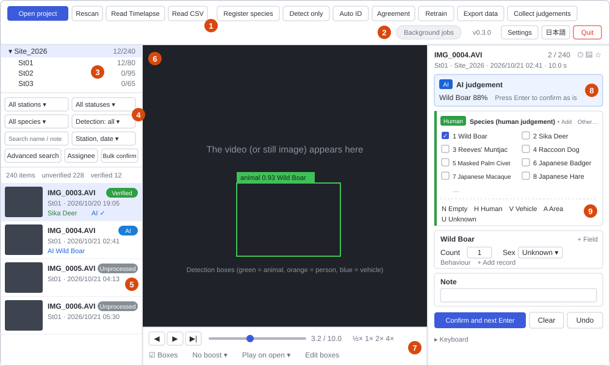

English | [日本語](manual.ja.md)

# TrapNote User Manual

This manual describes how to use the public edition of TrapNote v0.3.0 (the edition started from the normal desktop icon).
If you are new to TrapNote, read chapters 1–4 in order; they take you from opening your videos to exporting a CSV. Read chapter 5 onward when you need it.

## Contents

1. [What TrapNote does](#1-what-trapnote-does)
2. [Installing and starting](#2-installing-and-starting)
3. [The screen](#3-the-screen)
4. [Getting started](#4-getting-started)
5. [Verifying faster](#5-verifying-faster)
6. [Recording more information](#6-recording-more-information)
7. [Adapting the AI to your study site](#7-adapting-the-ai-to-your-study-site)
8. [Importing existing records](#8-importing-existing-records)
9. [Exporting in other formats](#9-exporting-in-other-formats)
10. [Sharing the work among people and PCs](#10-sharing-the-work-among-people-and-pcs)
11. [Merging several survey rounds](#11-merging-several-survey-rounds)
12. [Managing videos](#12-managing-videos)
13. [Where the data is kept and how to move it](#13-where-the-data-is-kept-and-how-to-move-it)
14. [Keyboard shortcuts](#14-keyboard-shortcuts)
15. [The three editions](#15-the-three-editions)
16. [Troubleshooting](#16-troubleshooting)
17. [Glossary](#17-glossary)

---

## 1. What TrapNote does

TrapNote reads camera-trap videos and still images, records the species of the animals in them, and exports the records as CSV. The work goes in this order:

1. **Open**: choose a video folder, and its videos appear in a list.
2. **Auto ID**: the AI finds animals, people and vehicles (MegaDetector) and suggests a species for each animal (SpeciesNet).
3. **Verify**: a person watches each video, confirms the suggestion if it is right and corrects it if it is wrong.
4. **Export**: the results are written to a CSV file. They can also be exported as Camtrap DP (the standard format for publishing and sharing data) or in YOLO format (training data for object detection).
5. **Retrain** (optional): the verified results are used to retrain the AI, which then judges the remaining videos and those of later surveys.

You can also record everything by eye without using the AI.

Good to know:

- Videos are never sent anywhere. All processing happens on your own PC.
- The results are kept together in a `TrapNote` folder created inside the video folder you open.
- The original videos are never modified. The only exceptions are "Archive convert" and deleting, both of which you run yourself ([chapter 12](#12-managing-videos)).

---

## 2. Installing and starting

### 2.1 Requirements

| Item | Details |
|---|---|
| OS | Windows (installer available). On macOS, install from the command line |
| Browser | Edge or Chrome |
| Disk | About 10 GB (Python environment and AI models) |
| Network | Only during installation and the first time the AI is used |
| GPU | Not required. An NVIDIA GPU (driver 570 or later) makes Auto ID and training faster |

### 2.2 Installing on Windows

1. Run `TrapNote-Setup-….exe` (from the [Releases page](https://github.com/YoshihiroNakashima/trapnote/releases/latest), or the file you were given).
   If Windows shows "Windows protected your PC", click "More info" and then "Run anyway".
2. Check the install folder and click "Install".
   - The default is `C:\TrapNote`. Use only ASCII letters and digits in the folder name.
   - Installation takes 10–30 minutes. Stay connected to the internet during that time.
   - An existing Anaconda or other Python installation on the PC is not affected (TrapNote creates its own Python environment inside the install folder).
3. When installation finishes, a "TrapNote" icon appears on the desktop.

The first time you use "Auto ID" or "Detect only", TrapNote downloads the AI models (about 300 MB in total). This also needs an internet connection.

### 2.3 Installing on macOS

With conda (Miniforge or similar) installed, run the following in Terminal:

```
git clone https://github.com/YoshihiroNakashima/trapnote.git
cd trapnote
conda env create -f env/trapnote-env.yml
conda activate trapnote
pip install --no-deps megadetector==10.0.28
python app.py
```

From the second time on, start TrapNote with `conda activate trapnote` followed by `python app.py`.

### 2.4 Starting and quitting

- **Start**: double-click the "TrapNote" icon on the desktop. The screen opens in its own window.
- **Quit**: click "Quit" at the top right of the screen. Closing the window alone leaves the program running in the background (clicking the icon again reopens the screen).
- To switch the interface language, click "日本語" at the top right (it reads "EN" in the Japanese interface), or use "Language" in "Settings".

### 2.5 Updating and uninstalling

- **Update**: run the new `TrapNote-Setup-….exe` and choose the same folder. Only the program is replaced; your settings, models and existing judgements are kept.
- **Uninstall**: delete the desktop icon and the install folder (`C:\TrapNote`). The `TrapNote` folders inside your video folders (the judgement results) remain unless you delete them yourself.
- **If installation fails**: see [chapter 16](#16-troubleshooting).

---

## 3. The screen



| No. | Name | What it does |
|---|---|---|
| 1 | Toolbar | Buttons that start tasks. From the left: Open project, Rescan, Read Timelapse, Read CSV, Register species, Detect only, Auto ID, Agreement, Retrain, Archive convert, Export data, Collect judgements |
| 2 | Background jobs, Settings, Quit | "Background jobs" shows the progress of scanning, Auto ID and other tasks. Click it to see details or to stop a job |
| 3 | Folder tree | Click a folder to list only the videos in it. The numbers are "verified / total" |
| 4 | Filters and sorting | Narrow down the list by station, status, species, detection result and more |
| 5 | List | One row per video. Click a row to play the video. The tag at the top right shows its status |
| 6 | Player | Shows the video (or still image). When "Boxes" is ticked, boxes are drawn where the AI found something |
| 7 | Playback controls | Previous and next video, frame stepping, playback speed, brightening dark videos and more |
| 8 | AI judgement | The species suggested by the AI and its confidence (the blue box) |
| 9 | Human judgement | Species checkboxes, fixed items such as Empty, fields such as group size, the note, and "Confirm and next". What you enter here is the record |

You can drag the borders between the panes (double-click a border to reset it).

Tags in the list:

| Tag | Meaning |
|---|---|
| Unprocessed | No judgement yet |
| AI | The AI has judged the video, but no person has verified it yet |
| Imported | A judgement imported from a CSV file or Timelapse, not verified yet |
| Verified | A person has confirmed the judgement |

---

## 4. Getting started

### 4.1 Preparing the video folder

If you keep one folder per station (a place where a camera was set), the folders can be used directly for filtering by station and for the station column of the CSV.

```
Site_2026/          ← open this folder
  St01/             ← one folder per station
    IMG_0001.AVI
    IMG_0002.AVI
  St02/
  St03/
```

Supported formats are AVI, MP4, MOV, MKV, M4V, MPG, WMV, MTS, 3GP and WebM for videos, and JPG and PNG for still images.

### 4.2 Opening a project

1. Click "Open project" at the top left.
2. In the card "Season project (a folder of videos)" on the left, click "Choose…", select the video folder (`Site_2026` in the example above) and click "Open".
   You can also paste the folder path into the box on the toolbar and press Enter.
3. The videos appear in the list. Their length and recording time are read one by one in the background (progress is shown under "Background jobs" at the top right).

A `TrapNote` folder is created inside the folder you opened. All results, such as judgements, are stored there.
Next time, you can choose the project from "Recent projects" under "Open project". After adding or removing videos, click "Rescan" to update the list.

> **About the recording time**: TrapNote looks for the recording time in the video's own metadata, then in the EXIF data, then in the file's modification time. AVI files often carry no recording time; the modification time is then used, and the list shows `(mtime)`. If the camera clock was wrong, you can correct it later ([6.4](#64-correcting-the-camera-clock)).

### 4.3 Choosing the station folders

For a new project, the window "Choose the station folder" opens after the folder has been read.

1. In the folder tree, click a folder that corresponds to a station (`St01` in the example above). All folders on the same level become stations.
2. Check the number of stations and videos in the table below.
3. Click "Use this level as the station".

- If you surveyed the same stations several times and each period has its own folder inside, also choose "Survey round (if any)". Usually you can leave it at "none".
- To change this later, click "Choose again…" next to "Station folder" in "Settings".
- You can also work without stations. The CSV then lists each folder level in the columns `Folder1`, `Folder2` and so on.

### 4.4 Registering species

The species shown in the right-hand panel, and the species that Auto ID can assign, come from the species list. Auto ID assigns only species marked "Use" in the list; other animals become "Unknown". Register the species that can occur at your study site before running Auto ID.

- A project created with the Japanese screen starts with 31 entries, mainly Japanese mammals.
- A project created with the English screen starts with no species ("Empty", "Human", "Vehicle", "Area" and "Unknown" are always there). The country of the study area is not set either.

1. Click "Register species" on the toolbar.
2. Type the country name or its three-letter ISO code (for example KEN) in "Country of the study area". The candidate species of that country (the species that SpeciesNet, the AI of Auto ID, knows) appear at once in the lower part of the window. Auto ID removes candidates that do not occur in the country.
3. In the "Registered species" table, tick "Use" for the species that can occur at your site. For species that are not in the table, tick them in the candidates below and click "Register the chosen"; they move into the table (only mammals are listed at first; birds and others can be shown too).
4. Add species that are not among the candidates with "+ Register species". There are three ways to register.
   - **Enter one species**: type the name and the scientific name. As you type the scientific name, TrapNote shows whether Auto ID can assign it.
   - **Register many from a CSV**: write a CSV with "Write the template…", add one species per row in Excel or similar, then load it with "Choose the CSV…". Before anything is registered, a table shows which species will be added and which will be changed.
   - **Choose from the SpeciesNet list**: the same list as the candidates in the lower part of the window (for when you come from "+ Add" in the right-hand panel).
5. Give frequently used species a "Key" (one character) so that you can select them from the keyboard.
6. Click "Save". Candidates that are still ticked are registered as well.

The candidates become available after the SpeciesNet model has been downloaded. Until then, the candidates area shows a "Download the model now" button (the same download as the first Auto ID run). Species registered from the candidates get their scientific name and their link to Auto ID filled in.

Each species has three kinds of name, one for each purpose.

| Name | Where it is used |
|---|---|
| Name | Shown on the screen: the English name on the English screen, the Japanese name on the Japanese screen (or the other one, then the scientific name, when it is missing) |
| Scientific name | Links the species to Auto ID (SpeciesNet) and to Camtrap DP exports |
| CSV label | The value written to the Species column of the exported CSV. Using the same labels as your existing CSV files makes the records easier to combine later |

The "Auto ID" column of the table shows whether Auto ID can assign the species.

| Shown | Meaning |
|---|---|
| species | SpeciesNet has this species |
| genus (also family, order, class) | SpeciesNet does not have this species, so candidates of the same genus are collected for it |
| none | Not assigned by Auto ID (no scientific name, or a name SpeciesNet does not have). You can still choose it by eye |
| not checked | Unknown until the SpeciesNet model has been downloaded |

> **Using TrapNote outside Japan**: set "Country of the study area" to your country (three-letter ISO code). With JPN, candidates that do not occur in Japan are removed. Leave it empty for no restriction.

### 4.5 Running Auto ID

1. Click "Auto ID" on the toolbar.
2. Check the "Range" (all videos, or the current filter). The other settings can usually stay at their defaults.
3. Click "Start". Progress is shown under "Background jobs" at the top right.

- If you stop part way, finished videos are skipped and the run continues where it left off when you start it again.
- You can keep verifying videos while Auto ID is running.
- Auto ID also works on a PC without a GPU. As a rough guide, a 20-second video takes 2–10 seconds with "Detect only" and 3–20 seconds with Auto ID (it depends on the CPU, and grows roughly in proportion to the length of the video). The actual time per video is shown under "Background jobs" (the figure before 秒/本, seconds per video). If one video takes tens of seconds, see [16. Troubleshooting](#16-troubleshooting).
- "Species that automatic identification can assign" in the window lists the species of your list that Auto ID can assign. Other animals become "Unknown". If there is none, Auto ID cannot be started: click "Register species" and register species first ([4.4](#44-registering-species)).

After Auto ID, each video ends up in one of these states:

| Result | Meaning |
|---|---|
| Species suggestion (tag "AI") | An animal was found and a species was suggested |
| Check | An animal seems to be present, but the AI was not confident enough to suggest a species |
| Empty | No animal, person or vehicle was found |
| Human, Vehicle | A person or a vehicle was found |

If you want to identify the species yourself, use "Detect only" instead of "Auto ID". It only draws boxes around animals, people and vehicles and does not suggest species.

### 4.6 Watching and confirming videos

Click a video in the list to play it. Check the judgement in the right-hand panel and confirm it.

- **The AI judgement is right**: press Enter. The judgement is confirmed and the next video opens.
- **The AI judgement is wrong**: change the species checkboxes, then press Enter. Species that have a key can also be toggled with that key. If a video shows two or more species, tick all of them.
- **No animal in the video**: press N (Empty) and then Enter. Use H for a person, V for a vehicle and U (Unknown) when the species cannot be told. A (Area) is the item for videos taken to check a camera's detection area.
- **Confirmed by mistake**: Ctrl+Z undoes the last confirmation. To fix it later, open the video and set the judgement again, or click "Clear".

Viewing aids:

- Tick "Boxes" below the player to see where the AI found animals.
- Dark videos can be brightened with the B key (display only; the records are not affected).
- Use , and . to step frame by frame, and [ and ] to change the playback speed. All keys are listed in [chapter 14](#14-keyboard-shortcuts).

> **Careful with the → key**: → and ← move to the next and previous video, but if species are ticked, the judgement is confirmed before moving.

### 4.7 Exporting to CSV

1. Click "Export data" on the toolbar.
2. Choose the "Range" (All, Current filter, Verified only).
3. Open the "CSV (table)" card (it is open at first), check "Save to", and click "Export CSV".

The CSV has **one row per video and species**. A video showing two species gives two rows. The main columns are:

| Column | Contents |
|---|---|
| Season, Station, File | Survey round, station and file name |
| DateTime | Recording time (for example `2026/10/20 19:05:21`) |
| DateTimeCorrected | The time after correcting the camera clock. The same as DateTime if no correction was made |
| Species | Species ("CSV label" in the species list; Empty for no animal, Human, Vehicle, Unknown) |
| Species_ja, Species_sci | Japanese name and scientific name |
| Status, Verified, VerifiedBy | Verification status and who verified the video |
| Note, Favorite | Note and favourite mark |
| AutoJudgement, Agree | The AI judgement and how it compares with the human judgement (match, partial, mismatch) |
| Flag, DetAnimal, DetPerson, DetVehicle, DetMaxConf | The "Check" flag (low) and a summary of the detections |
| Columns of extra fields | Fields you added yourself, such as group size ([6.1](#61-adding-fields-such-as-group-size-or-behaviour)) |

To export in Camtrap DP or YOLO format, see [chapter 9](#9-exporting-in-other-formats).

---

## 5. Verifying faster

### 5.1 Filtering and sorting

The controls above the list narrow down which videos are shown.

| Control | What it does |
|---|---|
| Station, survey round | Show only the videos of that station or survey round |
| Status | Filter by Unprocessed, unverified (with a judgement) or Verified |
| Species | Filter by species, based on either the human judgement or the AI judgement |
| Detection | Check, disagrees with the AI, agrees with the AI, no animal detected, number of boxes and more |
| Search name / note | Find videos by text in the file name or the note |
| Sorting | Station and date, date, name, status, confidence and more |
| ★ | Show favourites only |

Filters work independently of the folder selected in the tree, and they are kept the next time you start TrapNote. While a filter is active, a blue "Filters on n ✕" badge appears next to the count. **If the list is empty, click this badge first to clear the filters.**

"Advanced search" opens a separate window for detailed conditions (several stations or species to include or exclude, time of day, video length, recorded fields). Frequently used conditions can be saved.

### 5.2 Selecting several videos

- Ctrl+A selects everything in the current list. Shift+click selects a range, and Ctrl+click adds videos one by one. Esc clears the selection.
- While videos are selected, the right-hand panel acts on all of them. For example, choosing a species and clicking "Confirm and next" gives all selected videos the same judgement.
- The bar that appears above the list lets you mark the selected videos as favourites, delete them, and more. The same actions are available from the right-click menu.

### 5.3 Bulk confirm

"Bulk confirm" marks every unverified judgement in the current filter as verified. For example, if you first filter by "No animal (detector)", you do not have to watch the videos without animals one by one.

- Bulk confirm cannot be undone with Ctrl+Z. Check the filter before you use it.
- If the targets include videos on which detection put no box, you can run a "Spot check": you watch randomly chosen videos among them to estimate how many animals were missed. For example, if none of 100 checked videos shows an animal, the miss rate is at most about 3 % (95 % upper bound). The result is recorded in the project.

---

## 6. Recording more information

### 6.1 Adding fields such as group size or behaviour

You can add your own fields for anything you want to record besides the species (group size, sex, behaviour and so on).

- Click "+ Field" in the right-hand panel to add a field on the spot. The new field appears in the panel immediately and becomes a column of the CSV.
- A field is recorded either per species (group size, for example) or per video. Its type can be a choice, a checkbox, a number, free text, a time and more.
- For fields that may need several records per video, such as behaviour, tick 'Any number of records per video with "+" (like behaviour)'.
- To reorder, delete or fine-tune fields, use "Settings" → "Edit extra fields…".

### 6.2 When a species is not in the list

- "Other…" lets you choose species that are in the species list but not marked "Use".
- "+ Add" registers new species. Choose how to register (enter one species, from a CSV, or from the SpeciesNet list; see [4.4](#44-registering-species)). When you enter one species, it is selected for the video that is open.

### 6.3 Notes and favourites

- Write anything you notice in the "Note" box. It goes to the Note column of the CSV.
- ☆ (or the F key) marks a video as a favourite. Use it to find well-shot videos or unusual behaviour later.

### 6.4 Correcting the camera clock

1. Open a video whose correct time you know and click 🕓 at the top of the right-hand panel.
2. Enter the correct date and time for that video. This sets the size of the offset.
3. Choose where to apply the same offset ("This item only", "This folder", "This station", "Current filter").

The original time is kept. The CSV has both the original time (DateTime) and the corrected time (DateTimeCorrected).

---

## 7. Adapting the AI to your study site

At first, the species suggested by Auto ID come from a global model (SpeciesNet). Once you have verified enough videos, "Retrain" adapts the species identification to your own study site and cameras.

### 7.1 Methods

| Method | What it does | When to use it |
|---|---|---|
| Method A (light classifier) | Trains a light classifier on the features saved during Auto ID. Takes a few minutes, even on a CPU | Start with this one |
| Method B (retraining the model) | Retrains part of SpeciesNet itself. Needs a GPU and time | When method A is not enough |

### 7.2 Steps

1. **Run Auto ID** ([4.5](#45-running-auto-id)). Retraining uses information saved at that time.
2. **Verify and confirm videos** ([4.6](#46-watching-and-confirming-videos)). Verified videos are the training material. Species with only a few verified videos (fewer than 5 boxes usable for training) are left out of the training.
3. **Click "Retrain"**. The top of the window shows how many videos can be used for training. Choose a method, give the model a name and click "Start training".
4. **Look at the results**. Some of the stations (20 % by default) are set aside as held-out stations; the agreement before and after training is compared on the videos of those stations, which were not used for training. This evaluation needs at least 3 stations.
5. **Re-judge the videos**. Clicking "Re-judge" in the "Trained models" table replaces the AI judgements with those of the trained model. Verified judgements do not change. From then on, Auto ID also uses that model. You can switch back to the original SpeciesNet at any time.
6. As you verify more videos and the material grows, repeat steps 3–5.

### 7.3 Better training material

- **Videos where the AI got the species wrong**: just confirm them with the correct species.
- **Videos with a box on nothing**: do not delete the box; confirm the video as "Empty". The box is then used for training as an example of a false detection.
- **Choosing the box used for training**: training uses one box per video (the training frame). Open "Training boxes" in the right-hand panel to see the candidate boxes. Clicking a box stops the video at that frame, and confirming the video in that state makes that box the training frame. If you choose none, the box with the highest confidence is used automatically. Extra boxes on rocks or fallen logs can be excluded from training with the ✕ at the box's top right.
- **Videos that are not suitable for training**: videos that even a person can barely identify can be excluded from training with 🚫 at the top of the right-hand panel (they are still used for evaluation).

### 7.4 Checking how accurate the AI is

Click "Agreement" on the toolbar to see how well the human judgements and the AI judgements agree, overall and per species. A table also shows which species were mistaken for which. "Export CSV" saves the results.

To review only the videos where the two disagree, choose "Disagrees with AI" in the "Detection" filter of the list.

### 7.5 Using a trained model in other projects

- Clicking "Copy to shared" in the "Trained models" table makes the model available in the "Auto ID" window of other projects.
- With "Add other projects as material" in the retraining window, you can include the verified videos of other projects in the training.

---

## 8. Importing existing records

### 8.1 Read CSV

You can import the species names of CSV files you made before as judgements.

1. With a project open, click "Read CSV" on the toolbar.
2. Choose the CSV file and check the species column and the other settings. Where a species name in the CSV is not matched to a TrapNote species automatically, choose the species in the table.
3. Import the file.

- Videos are matched by the Season, Station and File columns. Rows that do not belong to this project are skipped.
- Imported judgements come in as unverified (the list tag reads "Imported"). If the CSV holds visual identifications you trust, choose "Import as verified (trust the existing visual IDs)".
- Videos that are already verified are not changed.

### 8.2 Read Timelapse

You can import a Timelapse2 template (.tdb) and its results (.ddb). "Read Timelapse" opens a window with four steps (choose the files, check what was read, decide how to import, import). In the table of step 2, choose which TrapNote species each Timelapse species code stands for.

---

## 9. Exporting in other formats

Besides CSV, you can export in formats used by other software. "Export data" on the toolbar opens a window with one card per format. Click the card of the format you need to open it (only one card is open at a time, and the window remembers the card you opened last). The "Range" at the top of the window (All, Current filter, Verified only) applies to every format.

| Format | Use |
|---|---|
| Camtrap DP | Publishing and sharing data, analysis in R ([9.1](#91-camtrap-dp-format)) |
| YOLO | Training data for object-detection models ([9.2](#92-yolo-format-images-and-labels)) |
| Timelapse2 and others | Continuing the work in other software ([9.3](#93-other-formats)) |

### 9.1 Camtrap DP format

[Camtrap DP](https://camtrap-dp.tdwg.org/) (Camera Trap Data Package) is the standard format for exchanging camera-trap data. Use it to publish and share data or to analyse them with R packages such as camtrapdp. TrapNote writes version 1.0.2 as four files in one folder.

| File | Contents |
|---|---|
| `datapackage.json` | Description of the data (title, contributor, period, area, list of taxa) |
| `deployments.csv` | Camera deployments. One row per station (latitude, longitude, start and end time) |
| `media.csv` | Videos and still images. One row each (recording time, file location) |
| `observations.csv` | Observations. One row per video and species (scientific name, count, who verified it and so on) |

Steps:

1. Click "Export data" and choose the "Range".
2. Open the "Camtrap DP format" card and fill in the fields. Fields marked "required" must be filled in before you can export. What you enter is kept in the project.
   - **Title** and **Contributor** (the name is required; organization and email are optional)
   - **Sampling design** (required): how the camera stations were chosen
   - **Capture method** and the **UTC offset of the camera clock** (`+09:00` for Japan)
   - **Description** and **License** (optional): a description of the data, and licenses for the data and for the videos and still images. Needed when you publish to GBIF
3. Load the station coordinates (only the first time).
   - "Write a template CSV…" creates a CSV listing the stations. Open it in a spreadsheet and enter the latitude and longitude in decimal degrees (for example `35.1203` and `140.0511`). If you know when the cameras were set up and retrieved, enter the times under Start and End.
   - Click "Read a station CSV…" and choose the CSV you filled in.
   - In a project with two or more survey rounds, the template has one row per survey round and station. A row with an empty Season applies to every survey round of that station, so if the coordinates do not change between rounds you can keep one row per station.
4. Look at the "required items" list near the top of the card. A missing item is marked ✗, with the name of the item and of the stations concerned (for example "Latitude and longitude of the stations: Missing for 2 station(s): St03, St07"). When every item is marked ✓, you can export.
5. Click "Export Camtrap DP".

If any required item is missing, no file is written (an earlier export in the same folder is left as it is). The written files are checked against the Camtrap DP definitions before they are put in place, so a package that does not follow the definitions is never produced. In R, read it like this:

```r
library(camtrapdp)
x <- read_camtrapdp("D:/Site_2026/TrapNote/exports/camtrap-dp/datapackage.json")
```

Good to know:

- The items Camtrap DP requires are the contributor name, the sampling design, the capture method, the latitude and longitude of every station in the exported range, and the capture time. If even one station lacks its latitude and longitude, you cannot export. To export only the stations whose coordinates you know, filter the list to those stations first and choose "Current filter" as the "Range".
- Videos and images without a capture time are not exported (their number and some examples are listed with "!"). Stations with videos outside the setup–retrieval period in the station table are also listed with "!" (you can still export). Check the camera clock and the dates in the station table.
- For stations without setup and retrieval times, the first and last video of the station are used as start and end. This is shorter than the time the camera was actually running, so enter the setup and retrieval times before calculating capture rates and the like.
- Each video is written as one "event". Judgements are written as follows:

| Judgement in TrapNote | observationType |
|---|---|
| A species | animal (scientificName comes from the species list) |
| Empty | blank |
| Human, Vehicle | human, vehicle |
| Unknown | unknown |
| Area | human (with cameraSetupType calibration) |
| No judgement | unclassified (unknown for "Check" videos, where the AI did not suggest a species) |

- Verified judgements get classificationMethod human; videos that still carry only the AI judgement get machine.
- The count, sex and behaviour fields go to the count, sex and behavior columns. Of the fields you added yourself, a field named "Life stage" (or "Age") goes to lifeStage (adult, subadult, juvenile) and a field named "Individual" (or "Individual ID") goes to individualID. Other fields go to observationTags.
- A video showing two species gives two rows in observations (observationID is `<file>#<species>`, different for each row). If you recorded the count or sex several times with "+", each record gets its own row (`<file>#<species>#1`, `#2`, …).
- Line breaks inside notes are replaced with a space (so that line-based tools and spreadsheets do not break the rows).
- The videos themselves are not exported. filePath in `media.csv` is the path relative to the video folder. Detection boxes are not exported either (use the YOLO format below for boxes).
- Species without a scientific name in the species list get an empty scientificName. Add the scientific names with "Register species" on the toolbar.
- Reading (`read_camtrapdp()`), conversion to Darwin Core (`write_dwc()`) and writing the metadata file for GBIF (`write_eml()`) were checked with the R package camtrapdp (0.6.1). `write_eml()` stops unless a description and a data license have been entered.

### 9.2 YOLO format (images and labels)

You can export your verified results as training data for object-detection models such as YOLO. Frames with boxes are extracted from the videos as images and written together with label files of the same name (text files holding the box positions).

```
yolo/
  Boar/                                    ← one folder per species
    images/St01_IMG_0001_t0001000.jpg      ← frame extracted from a video
    labels/St01_IMG_0001_t0001000.txt      ← boxes (class cx cy w h, 0–1)
  Deer/
  classes.txt                              ← class ids and names
```

1. Click "Export data" and choose "Verified only" as the "Range" (so that only videos checked by a person become training data).
2. Open the "YOLO format (images and labels)" card and choose the destination folder and the following options.

| Option | Choices |
|---|---|
| Frames from videos | **Training frames only** (one per video: the frame of the box used for retraining, see [7.3](#73-better-training-material)) or **Every frame with boxes** |
| Class id | **0 = animal** (animal boxes only) or **One id per species** (boxes of people and vehicles are written too) |
| One folder per species | When off, everything goes into two folders, `images` and `labels` |
| Write images too | When off, only the labels are written |

3. Click "Export YOLO". Progress is shown under "Background jobs" at the top right.

Good to know:

- An image is named after its folders and file name, followed by the time of the frame in milliseconds. Videos with the same file name at different stations do not collide.
- Only boxes at or above the judgement thresholds are written. Boxes you excluded from training with ✕ in "Training boxes" are left out.
- If a video confirmed as "Empty" has boxes, its frame is written as an image without boxes (background). This helps a model learn to avoid false detections. Videos without any box are not written.
- Still images are copied as they are.
- "Every frame with boxes" can produce dozens of images per video. Check the free disk space first.

### 9.3 Other formats

| Format | Contents |
|---|---|
| Judgement index (`TrapNote/judgements.csv`) | The judgements of all videos, always written to the same place. Useful for reading into R and similar tools |
| Detection boxes (MegaDetector JSON) | The detection boxes in MegaDetector's standard JSON, readable by Timelapse2 and other tools |
| Timelapse2 (.tdb and .ddb) | A Timelapse2 template and data file, so that the work can continue in Timelapse2 |

---

## 10. Sharing the work among people and PCs

> **Do not open the same project from two PCs at the same time.** Judgements may not be saved correctly. To share the work, use "Collect judgements" as described below.

### 10.1 Collect judgements

1. Prepare the same video folder on each PC and do the work there.
2. When the work is done, click "Collect judgements" → "Export judgements" on each PC. The judgements are written to a single file (JSON).
3. On the coordinating PC, click "Collect judgements" → "Import judgements…" and choose those files.

The import rule is "verified > Auto ID > unprocessed". Videos that are verified on both sides with different contents are kept as conflicts, and you choose on the screen which one to keep.

### 10.2 Marking who does what

- Enter your name in "Your name (recorded as verifier)" in "Settings" to record who confirmed each judgement (the VerifiedBy column of the CSV).
- "Assignee" above the list gives the videos in the current filter the name of the person in charge.

### 10.3 Handing over videos

Select videos in the list, right-click, choose "Export videos… (selected videos)" and pick "Openable in TrapNote". This creates a folder that holds the videos together with their judgements. The recipient can open it with "Open project" ([12.2](#122-exporting-videos)).

---

## 11. Merging several survey rounds

After working on each survey round in its own project, you can merge the results into one CSV. No videos are copied.

1. Click "Open project", give the folder for the merged results in the card "Merge survey rounds" on the right, and click "Create and open".
   A drive root, the app folder and the parent folder of the videos cannot be used.
2. Click "Merge steps" on the toolbar and follow the steps in the window.

| Step | What to do |
|---|---|
| 1. Register sources | Register the projects of the survey rounds to merge (or a parent folder that holds the folders of the survey rounds) |
| 2. Species name mapping | If species names are written differently in different survey rounds, decide which name stands for which species |
| 3. Build the list of all videos | Make a list of every video in the registered survey rounds |
| 4. Export merged CSV | Write one CSV with a survey-round column |

---

## 12. Managing videos

### 12.1 Archive convert

"Archive convert" converts MJPEG AVI and similar files to H.264 MP4 to save storage. The resolution and the number of frames stay the same.

> **This replaces the original videos.** Before you run it, always check what will happen to the original files (keep them, move them to another folder, or delete them once the check has passed). If you choose to delete them, they cannot be recovered.

- The converted file is created in the same folder under the same name (with the extension .MP4). The recording time and the judgements are carried over.
- If you stop part way, finished files are skipped when you start again.
- Conversion is faster with an NVIDIA GPU.

### 12.2 Exporting videos

Select videos in the list, right-click and choose "Export videos… (selected videos)" to export the selected videos to another folder.

| Export as | What you get |
|---|---|
| Video files only | The videos and a list in CSV (`video_list.csv`) |
| Openable in TrapNote | The videos and a `TrapNote` folder (judgements, boxes, notes and so on). The exported folder can be opened with "Open project" |

AVI and similar files can be converted to MP4 while exporting. If you export to the same destination again, files that are already there are skipped and the export continues from where it stopped.

### 12.3 Deleting

Select videos in the list and delete them with "Delete (to recycle bin)" in the right-click menu or with the Delete key.

> **This moves the video files themselves to the Recycle Bin.** Their judgements are deleted too and cannot be restored in the app. If the files cannot be moved to the Recycle Bin (on a network drive, for example), they are deleted permanently.

---

## 13. Where the data is kept and how to move it

### 13.1 Project data

The results are in the `TrapNote` folder inside the video folder you opened.

| File or folder | Contents |
|---|---|
| `data.sqlite` | Judgements, field values and history. This is the most important file |
| `project.json` | Project settings |
| `species.csv`, `fields.json` | Species list and extra fields |
| `stations.csv` | Station coordinates and related details (loaded for the Camtrap DP export, see [9.1](#91-camtrap-dp-format)) |
| `exports/` | Exported CSV files and other exports |
| `models/` | Models made by retraining |
| `cache/` | Playback videos, thumbnails, information for training and so on. Rebuilt when needed if deleted |

- **Backup**: copy the `TrapNote` folder. You can leave out `cache/video` and `cache/crops`. Keep `cache/features` and `models/`, because they take a long time to rebuild.
- **Moving to another drive or PC**: copy the video folder together with the `TrapNote` folder inside it. At the new location, open the folder once with "Open project".
- **When the disk is full**: playback videos and other caches can be deleted under "Caches" at the bottom of "Settings". Your original videos and judgements are not affected.

### 13.2 App data

The `data` folder inside the install folder (`C:\TrapNote`) holds the app-wide settings, the downloaded AI models and the log (`app.log`).

---

## 14. Keyboard shortcuts

| Key | Action |
|---|---|
| Enter | Confirm and go to the next video (Ctrl+Enter inside the note box) |
| Ctrl+Z | Undo the last confirmation |
| Digits, letters | Toggle species (as set in the "Key" column of the species list) |
| N / H / V / A / U | Empty / Human / Vehicle / Area / Unknown |
| → / ← | Next / previous video (if species are ticked, the judgement is confirmed before moving). PageDown / PageUp do the same |
| Space | Play or pause |
| , / . | Back / forward one frame (< and > for 10 frames) |
| Home / End | Go to the start / end of the video |
| [ / ] | Slower / faster playback |
| L | Loop playback |
| B | Cycle the brightening of dark videos (- and + for weaker and stronger) |
| ↑ / ↓ | Go to the frame of the previous / next box in "Training boxes" |
| F | Favourite |
| Ctrl+A | Select everything in the list |
| Delete | Delete the selected videos (read the warning in [12.3](#123-deleting)) |
| Esc | Close a window or clear the selection |

You can also check the keys on the screen by opening "Keyboard" at the bottom of the right-hand panel.

---

## 15. The three editions

TrapNote comes in three editions that run the same program. They share the same project format and differ only in which features appear on the screen.

| Edition | How to start | Contents |
|---|---|---|
| Public | The "TrapNote" icon (`起動.bat`) | Everything in this manual |
| Lite | The "TrapNote Lite" icon (`起動（Lite）.bat`) | Detection (MegaDetector) and verification by eye. No species AI, agreement or retraining |
| Research | `起動（研究用）.bat` | The public edition plus random sampling from large video collections, accuracy measurement with evaluation batches and more. The procedures are in the [technical notes](technical-notes.md) (in Japanese) |

The Lite icon is created when you tick "Also create an icon for TrapNote Lite (detection and manual verification only)" during installation.
If you start one edition while another is running, the running one is stopped and the new one starts, provided no job is running. If a job is running, it is not stopped and TrapNote tells you so.

---

## 16. Troubleshooting

| Problem | What to do |
|---|---|
| Running the installer shows "Windows protected your PC" | Click "More info" and then "Run anyway" (the installer is not signed) |
| Installation fails part way | See `install.log` in the install folder. If an existing Python environment seems to be the cause, tick "Do not reuse an existing Python environment (trapnote); create it in a private Miniforge" in the installer and try again |
| The list is empty | Click "Filters on n ✕" next to the count to clear the filters. Also check that a different folder is not selected in the folder tree |
| Added videos do not appear in the list | Click "Rescan" |
| The "Auto ID" window says "torch / megadetector / speciesnet are not installed" | The parts that run the AI are missing. Run the installer again |
| The models cannot be downloaded | The first Auto ID needs an internet connection (the models come from GitHub and Kaggle). Check that your organisation's network does not block them |
| Auto ID runs on the CPU although there is a GPU | An old NVIDIA driver prevents GPU use. Update the driver to version 570 or later |
| On a PC without a GPU, Auto ID or Detect only takes tens of seconds per video | (1) Update TrapNote ([2.5](#25-updating-and-uninstalling)). On CPUs that have performance and efficiency cores (Intel 12th generation and later, Core Ultra), versions before 21 November 2026 let Windows run TrapNote's computation on the efficiency cores only. (2) Set "MegaDetector" in the Auto ID window to "auto". redwood and MDv5 are meant for GPUs and take more than 20 times longer on a CPU. (3) Plug in a laptop. (4) Long videos take roughly proportionally longer |
| It takes a while from opening a video until it plays | Videos in formats the browser cannot play directly are converted for playback first. The next few videos are prepared in advance, so you do not wait when watching them in a row |
| The recording time is wrong | Videos marked `(mtime)` in the list use the file's modification time. Correct it with 🕓 ([6.4](#64-correcting-the-camera-clock)) |
| The "Advanced search" window does not open | The browser is blocking pop-ups. Allow them |
| "Retrain" says there are no videos to train on | Run Auto ID first, then verify and confirm videos ([7.2](#72-steps)) |
| The disk is full | Playback videos and other caches can be deleted under "Caches" at the bottom of "Settings" |
| The Camtrap DP export reports "required value missing" | The latitude and longitude of the stations have not been loaded. Enter them in the station CSV and load it ([9.1](#91-camtrap-dp-format)) |
| The YOLO export produces no images | No video with boxes is in the range. Run Auto ID (or Detect only) first. Videos without boxes are not exported ([9.2](#92-yolo-format-images-and-labels)) |
| "Could not restart" is shown | A job is running in another edition. Start TrapNote again after the job has finished |

If the problem persists, report it on GitHub Issues or to the person who gave you TrapNote, and attach `data\app.log` from the install folder (or `install.log` for installation problems).

---

## 17. Glossary

| Term | Meaning |
|---|---|
| Project | One video folder together with its results (the `TrapNote` folder) |
| Survey round | One survey, from setting the cameras to collecting them. Usually one project is one survey round ("Season" in the CSV) |
| Station | A place where a camera was set. Usually one folder per station |
| Judgement | The record of the species and other items for a video. It is made either by the AI or by a person |
| Verified | A judgement confirmed by a person. The CSV and retraining treat it as a correct record |
| Check | The flag for videos on which the AI was not confident enough to suggest a species |
| Detection box | A rectangle showing where the AI found an animal, a person or a vehicle |
| Fixed items | Items that exist in every project besides the species (Empty, Human, Vehicle, Area, Unknown) |
| Extra fields | Fields you added yourself, such as group size or behaviour |
| Training frame | The one box per video that is used for retraining |
| Held-out stations | Stations set aside during retraining; they are not used for training and serve to measure accuracy |
| Agreement | The share of videos on which the human judgement and the AI judgement agree |
| Camtrap DP | The standard format for exchanging camera-trap data (Camera Trap Data Package) |
| YOLO format | A format for training data of object-detection models: images paired with text files (labels) that hold the box positions |
